# Introdução

Este repositório explica e documenta a atividade prática de **testes de caixa cinza em uma API de autenticação**, realizada por mim, **Renan Almeida**.

Foi criado um ambiente de autenticação na plataforma **Supabase** e, em seguida, foram executados testes funcionais sobre o endpoint de login utilizando o aplicativo **Postman Desktop**. Todo o processo, desde a configuração à análise final, está documentado neste README, com evidências produzidas por mim durante a atividade.

**Estrutura do repositório:**

```
/README.md
/postman/    -> collection exportada do Postman
/prints/     -> evidências (capturas de tela)
/planilha/   -> planilha de registro dos testes
```

---

# Objetivo da Atividade

Compreender e aplicar **testes de caixa cinza** em APIs de autenticação, utilizando ferramentas de mercado para configurar, executar e validar testes funcionais.

Nos testes de caixa cinza o testador conhece parte da estrutura do sistema. Neste caso, são conhecidos:

- o endpoint de autenticação;
- o mecanismo de autenticação (e-mail e senha);
- os headers necessários;
- o formato do body JSON;
- as respostas HTTP esperadas.

Os objetivos específicos foram: configurar o Supabase, criar um usuário de teste, entender requisições HTTP, executar cenários de teste no Postman, validar as respostas (status, JSON, mensagens de erro e token) e documentar tudo tecnicamente.

---

# Configuração do Supabase

## Como o projeto foi criado

1. Criei uma conta no Supabase (supabase.com).
2. Criei uma **organização** chamada `teste-auth-renan-almeida` (tipo *Educational*, plano *Free*).
3. Dentro dela, criei o projeto `auth-renan-almeida`.
4. Aguardei o provisionamento e confirmei que o status do projeto estava **Healthy**.

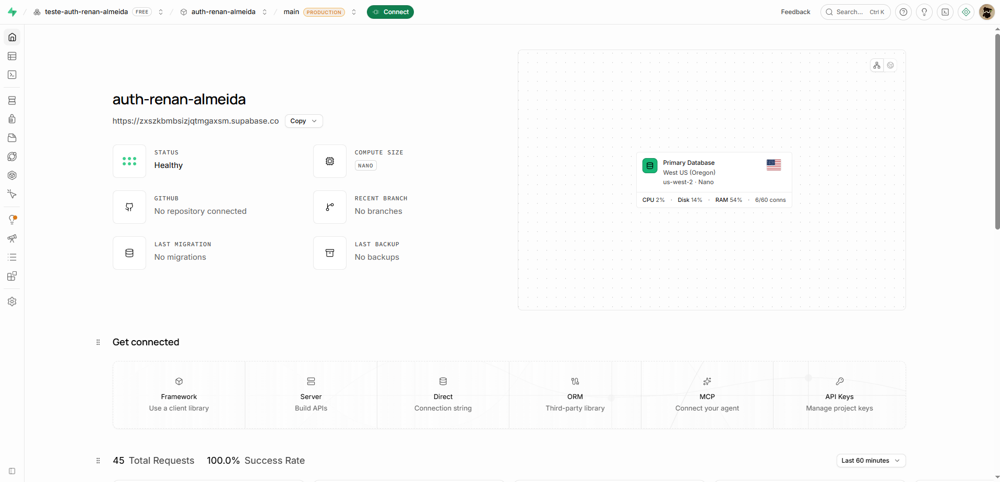

## Tipo de autenticação utilizada

Foi utilizada a **autenticação por e-mail e senha** (provider *Email*), que está **habilitado** em *Authentication → Sign In / Providers*.

A opção **Confirm email** foi desativada para que o usuário de teste pudesse fazer login imediatamente, sem precisar confirmar o e-mail.

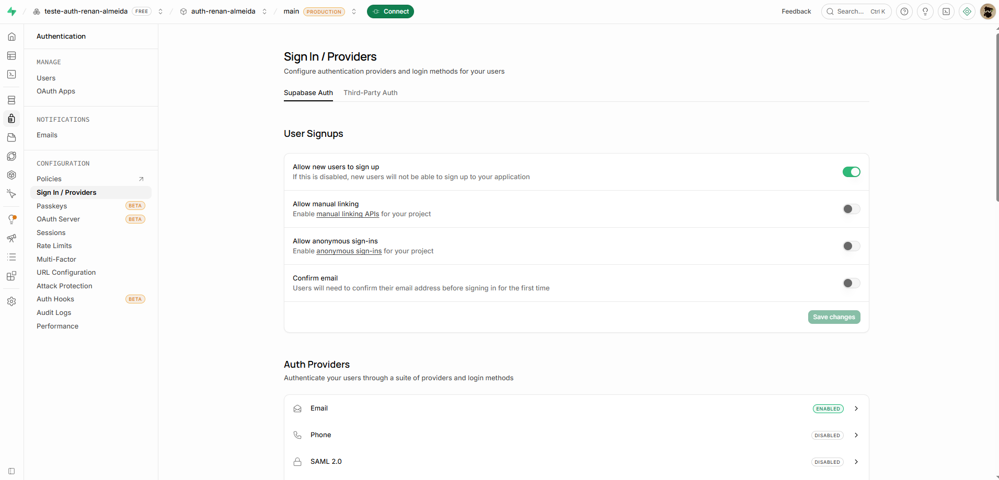

## Como o usuário de teste foi criado

Em *Authentication → Users*, usei **Add user → Create new user** e cadastrei o usuário `renan.almeida@email.com`, com uma senha definida por mim e a opção *Auto Confirm User* marcada.

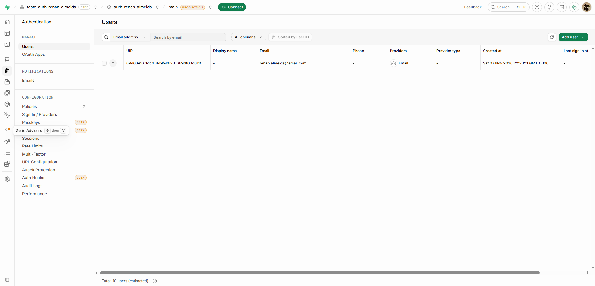

## Credenciais da API

Em *Settings → API Keys* obtive os dados necessários para os testes:

- **API URL:** `https://zxszkbmbsizjqtmgaxsm.supabase.co`
- **API KEY:** chave do projeto (parcialmente oculta no print, por segurança).

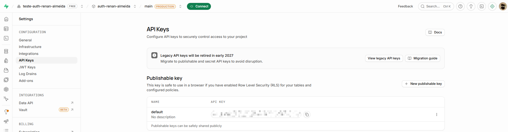

## Identificação do aluno

O nome do aluno aparece na organização (`teste-auth-renan-almeida`) e no projeto (`auth-renan-almeida`), conforme a tela de configurações do projeto.

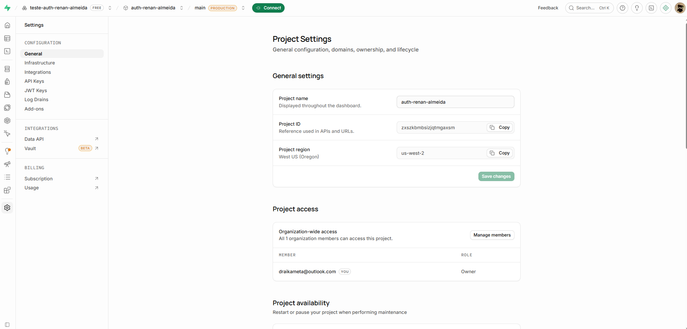

## Objetivo da configuração

Disponibilizar uma API de autenticação real e um usuário válido, para que o endpoint `/auth/v1/token?grant_type=password` possa ser testado com cenários de sucesso e de falha.

---

# Configuração do Postman

## Workspace

Foi criado um Workspace chamado `Testes Auth Supabase - Renan Almeida` para reunir em um único lugar a collection, o environment e todas as requisições da atividade.

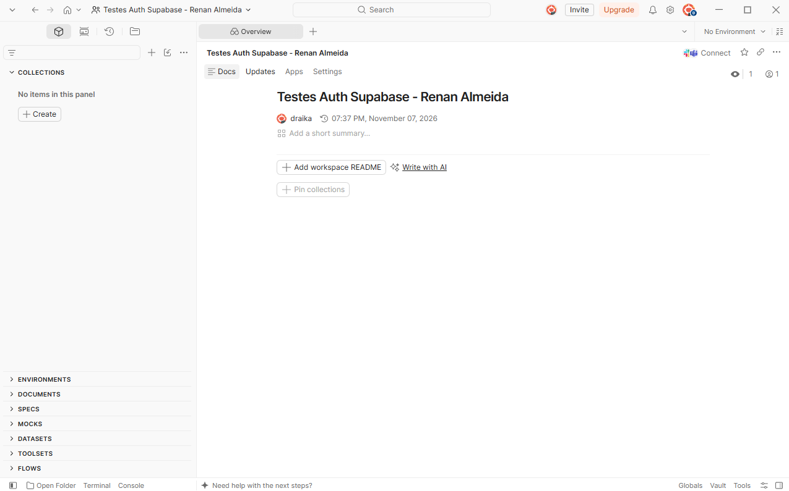

## Environment e variáveis

Foi criado um Environment chamado `Supabase` com as variáveis abaixo. O uso de variáveis evita repetir valores em cada requisição e facilita a manutenção: se a chave ou a URL mudarem, basta alterar em um só lugar.

| Variável   | Descrição                   |
|------------|-----------------------------|
| `base_url` | URL da API do Supabase      |
| `api_key`  | API KEY do projeto          |
| `email`    | Usuário criado para teste   |
| `password` | Senha do usuário            |

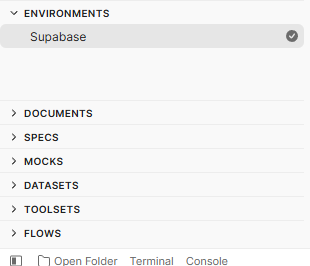

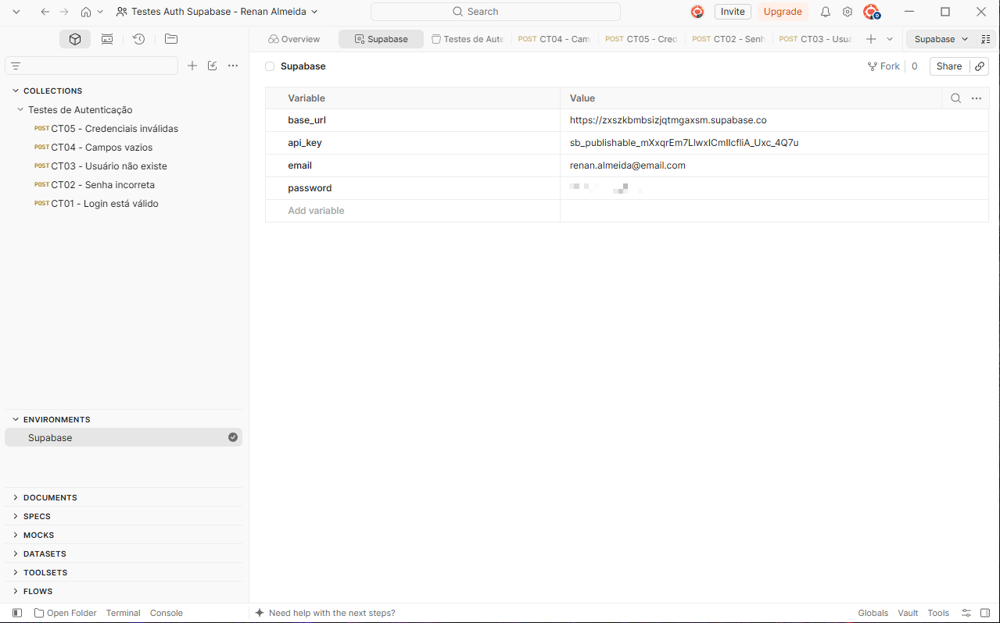

## Como o Postman é utilizado nos testes

As requisições ficam organizadas em uma Collection (`Testes de Autenticação`) e usam as variáveis do Environment (`{{base_url}}`, `{{api_key}}`, `{{email}}` e `{{password}}`). Cada cenário de teste é uma requisição separada em que só o body muda. O Postman permite enviar a requisição, ver o status HTTP, o tempo de resposta e o JSON retornado.

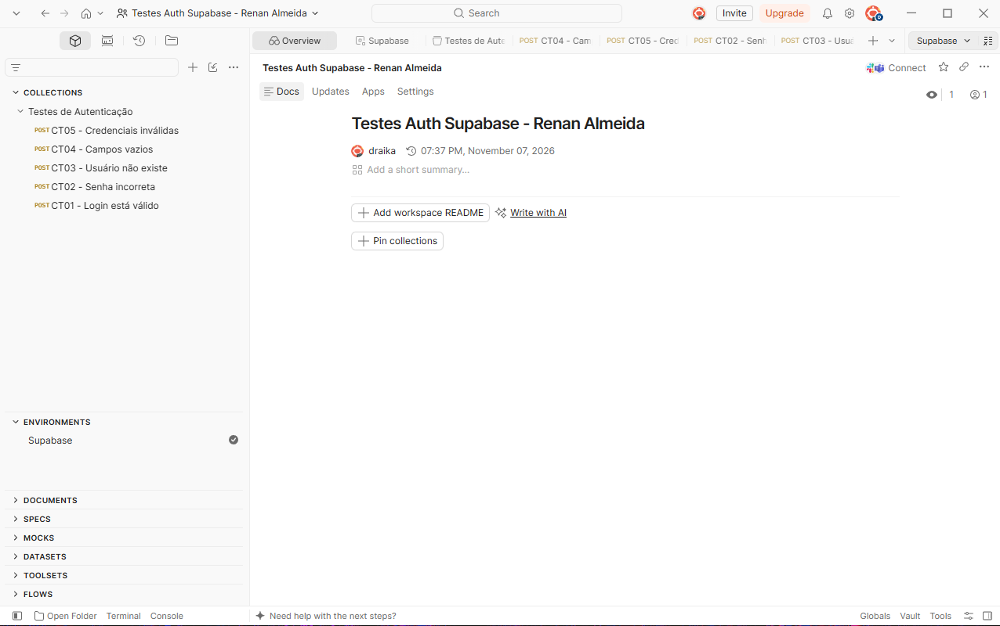

---

# Configuração das Requisições

- **Endpoint:** `{{base_url}}/auth/v1/token?grant_type=password`
- **Método HTTP:** `POST`
- **Finalidade:** autenticar um usuário com e-mail e senha (fluxo *password grant*) e obter um **access token** em caso de sucesso.

## Exemplo de Header

| Header          | Valor              |
|-----------------|--------------------|
| `apikey`        | `XXXXX`            |
| `Authorization` | `Bearer XXXXX`     |
| `Content-Type`  | `application/json` |

> Os valores reais da chave foram omitidos por segurança.

## Exemplo do Body JSON

```json
{
  "email": "usuario@email.com",
  "password": "123456"
}
```

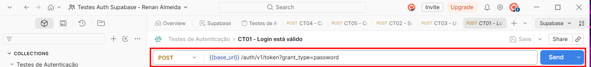

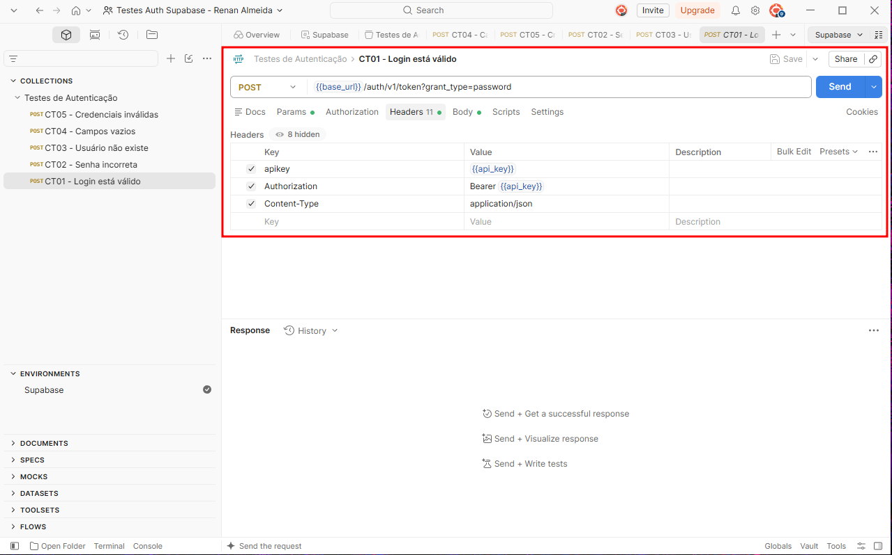

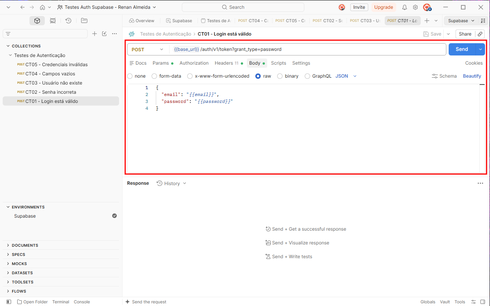

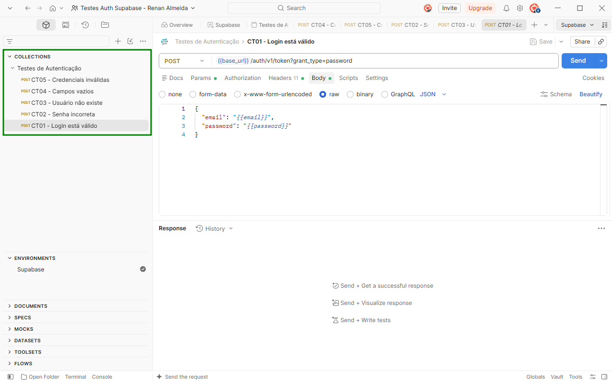

---

# Execução dos Testes

Foram executados os 5 cenários obrigatórios, sempre sobre o mesmo endpoint, alterando apenas o body. Em cada um foram validados: status HTTP, corpo JSON da resposta, mensagem de erro e presença (ou ausência) do access token.

## Tabela de Cenários

| Cenário               | Entrada Utilizada                                  | Resultado Esperado        | Resultado Obtido                                                        | Status |
|-----------------------|----------------------------------------------------|---------------------------|-------------------------------------------------------------------------|--------|
| Login válido          | `renan.almeida@email.com` + senha correta          | Status 200 + access token | 200 OK, `access_token` retornado, `token_type` bearer, `expires_in` 3600 | OK |
| Senha incorreta       | `renan.almeida@email.com` + `errada123`            | Erro de autenticação      | 400 Bad Request, `invalid_credentials`, "Invalid login credentials"     | OK |
| Usuário inexistente   | `email.inexistente@email.com` + `senha12345`       | Acesso negado             | 400 Bad Request, `invalid_credentials`, "Invalid login credentials"     | OK |
| Campos vazios         | e-mail e senha vazios                              | Erro de validação         | 400 Bad Request, `validation_failed`, "missing email or phone"          | OK |
| Credenciais inválidas | `abcde` + `12345`                                  | Mensagem de erro          | 400 Bad Request, `invalid_credentials`, "Invalid login credentials"     | OK |

## Erros encontrados

Nenhum cenário apresentou comportamento fora do esperado: todos os testes responderam com o status e a mensagem previstos. Foram feitas duas observações:

- **Senha incorreta e usuário inexistente retornam exatamente a mesma resposta.** A API não informa se o erro foi na senha ou no usuário, o que evita que alguém descubra quais e-mails estão cadastrados.
- **E-mail em formato inválido (`abcde`) não gerou erro específico de formato.** A API tratou o caso como credenciais inválidas e negou o acesso do mesmo jeito.

## Evidências

**Login válido (CT01):** status 200 OK e access token retornado (parcialmente ocultado).

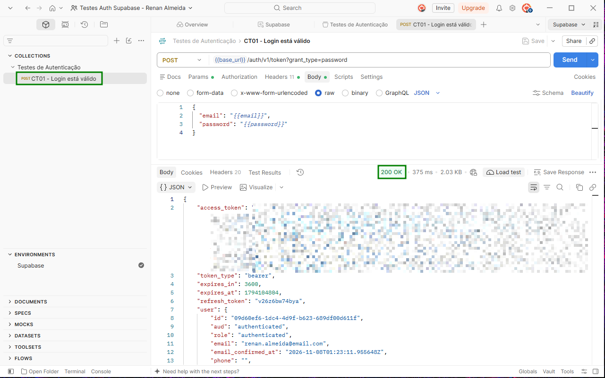

**Senha incorreta (CT02):**

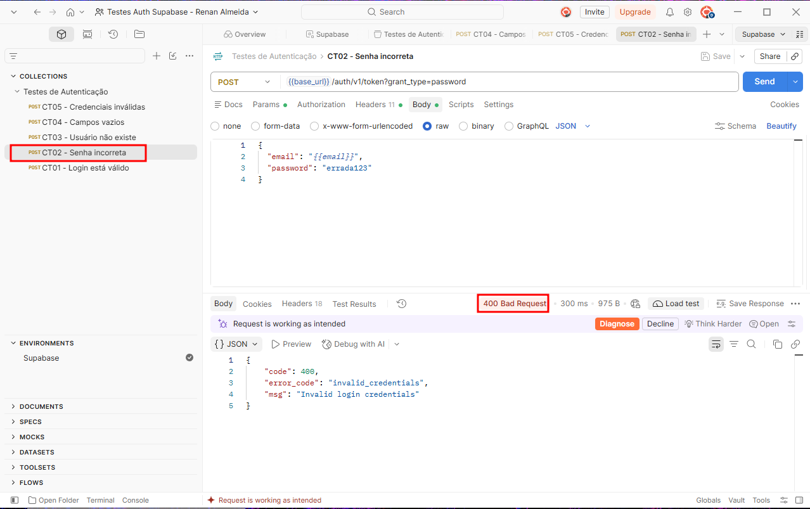

**Usuário inexistente (CT03):**

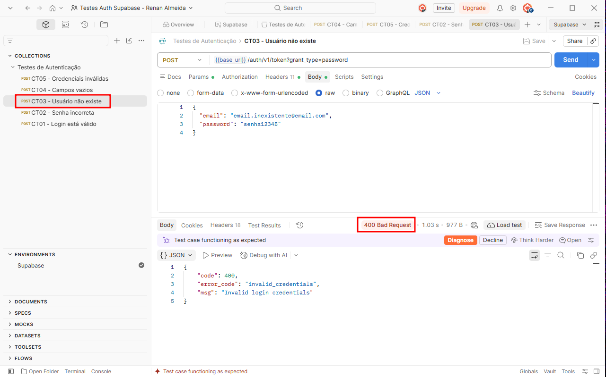

**Campos vazios (CT04):**

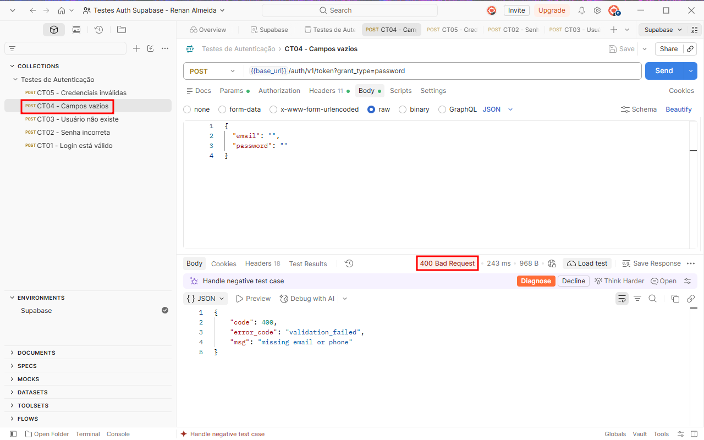

**Credenciais inválidas (CT05):**

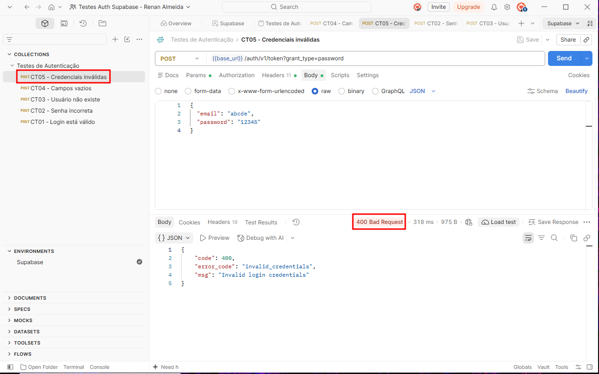

---

# Registro dos Testes

Os testes foram registrados na planilha [`planilha/planilha-testes.xlsx`](planilha/planilha-testes.xlsx), com os campos: ID do teste, cenário, entrada, resultado esperado, resultado obtido, status e observações. Cada execução no Postman gerou uma linha na planilha, preenchida logo após o teste, com o status HTTP e o trecho principal da resposta.

**Importância da documentação dos testes:** documentar os testes permite repetir os mesmos cenários no futuro, comparar resultados entre versões da API, comprovar o que foi verificado e facilitar a comunicação com outras pessoas da equipe. Sem registro, não há como saber o que foi testado nem reproduzir uma falha encontrada.

**Falhas identificadas:** não foram identificadas falhas. Os cinco cenários tiveram o resultado esperado, com as observações descritas na seção anterior.

A collection completa, exportada do Postman, está em [`postman/`](postman/).

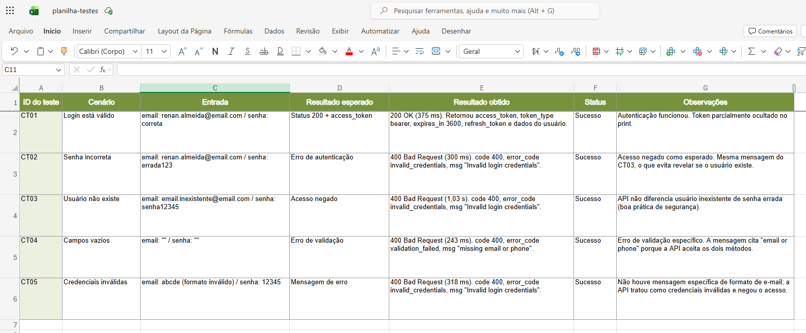

---

# Resultados Obtidos

Dos 5 cenários executados, os 5 tiveram o resultado esperado (5 sucessos e 0 falhas).

- No **login válido**, a API respondeu 200 OK e retornou o `access_token` (JWT), com `token_type` bearer e validade de 3600 segundos, além do `refresh_token` e dos dados do usuário.
- Em **todos os cenários inválidos**, a API respondeu **400 Bad Request** e não retornou token, ou seja, o acesso foi negado.
- Senha errada, usuário inexistente e e-mail em formato inválido retornaram o mesmo erro (`invalid_credentials`), enquanto os campos vazios retornaram um erro de validação próprio (`validation_failed`).
- Os tempos de resposta ficaram entre 243 ms e 1,03 s.

---

# Conclusão

**Execução dos testes:** todos testes foram executados corretamente. Os cinco cenários obrigatórios foram cobertos no Postman e todos os resultados foram registrados com prints e na planilha.

**Funcionamento da autenticação:** a autenticação proposta funcionou como esperado. O usuário válido recebeu o access token, e todas as tentativas inválidas foram bloqueadas com erro 400 e mensagem apropriada*, sem retornar token.

**Dificuldades encontradas:** a principal dificuldade foi a instalação do Postman Desktop, porque o download do instalador foi extremamente lento e instável na minha conexão, o que atrasou o início da etapa de testes.

**Falhas identificadas:** nenhuma falha de funcionamento foi encontrada. Como observação, a API não retorna mensagem específica para e-mail em formato inválido, tratando o caso como credenciais inválidas.

**Melhorias possíveis:**

- possivelmente automatizar as verificações com scripts na aba de *Tests* do Postman (assertions de status e de campos do JSON);
- executar a collection de forma automatizada com o Newman, inclusive em pipelines de CI;
- ampliar a cobertura com mais cenários (e-mail com espaços, senha muito longa ou curta, caracteres especiais, múltiplas tentativas seguidas para observar bloqueio por limite de requisições, token expirado);
- testar também o fluxo de refresh token e o logout;
- separar os dados sensíveis (chaves e senhas) em novas variáveis secretas do Postman.

**Importância dos testes caixa cinza em APIs:** como o testador conhece o endpoint, os headers e o formato dos dados, é possível montar cenários mais precisos e eficientes do que em um teste totalmente às cegas, e sem precisar de acesso ao código-fonte. Em APIs de autenticação isso é especialmente importante, porque falhas de validação ou de tratamento de erros podem permitir acesso indevido, expor informações demais nas mensagens ou comprometer a segurança dos usuários.
